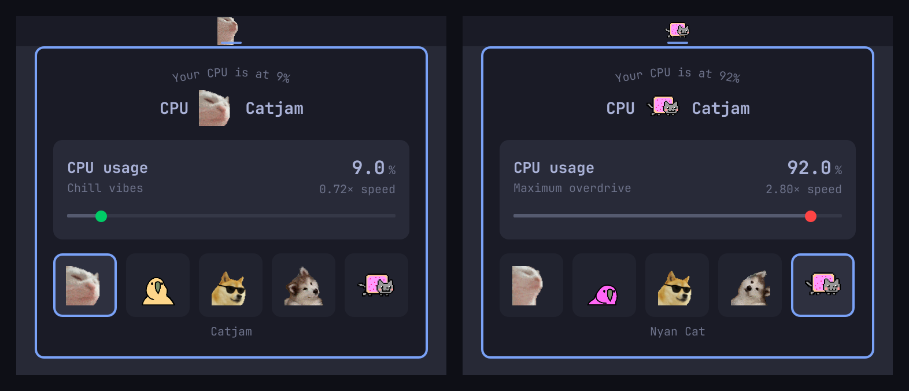

# CPU Catjam

A stupid fun CPU visualizer for Omarchy Quattro that plays the iconic catjam gif faster or slower based on your CPU usage. Higher CPU = faster jams!



## Features

- Animated gif in the bar that speeds up with CPU usage, from 0.5× when idle to 3× at 100%
- Five animations to pick from: Catjam, Parrot, Cool Doge, Confused Dog and Nyan Cat
- Hover tooltip shows the exact CPU percentage
- Click to open a panel with the current load, the animation speed and the animation picker
- Minimal performance impact: one `vmstat` sample about every 2.5 seconds

## Install

```sh
omarchy plugin add https://github.com/SjoenH/omarchy-cpu-catjam.git --enable
```

## Usage

The catjam will automatically appear in your bar and start jamming! The animation speed follows your CPU:

- **0-20% CPU**: Chill vibes (around 0.5× speed)
- **20-60% CPU**: Getting into it
- **60-100% CPU**: MAXIMUM OVERDRIVE (up to 3× speed)

- **Hover** over the catjam to see the exact CPU percentage
- **Click** to open the panel: the load as a number and on a track, how fast the animation is playing, and every animation as a tile
- **Click a tile** to switch animation. The choice is saved to `shell.json` and survives restarts.

## Configure

Move it to a different bar section:

```sh
omarchy bar move no.koka.cpu-catjam --section left
```

The chosen animation is the widget's `gif` setting in `~/.config/omarchy/shell.json`: one of `catjam.gif`, `parrot.gif`, `cool-doge.gif`, `confused_dog.gif` or `nyancat.gif`. Anything else falls back to catjam.

## Remove

```sh
omarchy plugin remove no.koka.cpu-catjam
```

## Development

The spec runs against the real widget and panel, with the installed Omarchy UI kit, in a headless Quickshell. No window appears and `shell.json` is not touched:

```sh
tests/run.sh
```

## Credits

- Catjam gif from the internet meme culture
- Panel layout after Omarchy's world clock
- Built for Omarchy Quattro
- By [koka.no](https://koka.no)

## License

MIT License - See LICENSE file for details
